# Kubernetes Rolling Updates and Rollback of Deployments

## Cloud Computing – Evaluation 2

### Problem Statement

Deploy an application on Kubernetes and update it to a new image version without downtime. Demonstrate how a faulty update is reverted using rollback.

---

## 1. Introduction

Kubernetes is a container orchestration platform used to deploy, manage and scale containerized applications.

A Kubernetes Deployment manages application Pods and provides features such as rolling updates and rollback.

A rolling update gradually replaces old Pods with new Pods when an application image is updated. This helps maintain application availability during an update.

Rollback allows us to restore a previously working version when an update fails.

In this experiment, an Nginx application is deployed on a Kubernetes cluster. The application is updated to a new image version, a faulty image is introduced deliberately, and the Deployment is rolled back to the previous working version.

## 2. Objectives

- Deploy an Nginx application using a Kubernetes Deployment.
- Run multiple replicas of the application.
- Configure the RollingUpdate deployment strategy.
- Update the application to a new image version.
- Monitor the update using `kubectl rollout status`.
- Deploy a faulty image to demonstrate an unsuccessful update.
- Restore the previous working version using rollback.
- Verify application availability and rollout history.

## 3. Tools and Technologies Used

| Tool | Purpose |
|---|---|
| Windows 11 | Host operating system |
| Docker Desktop | Container runtime |
| Kubernetes | Container orchestration |
| kind | Local Kubernetes cluster |
| kubectl | Kubernetes command-line tool |
| Nginx | Sample web application |
| PowerShell | Command execution |

## 4. Kubernetes Cluster Configuration

The experiment was performed using a three-node kind cluster.

**Cluster nodes:**

- kind-control-plane
- kind-worker
- kind-worker2

**Application details:**

| Parameter | Configuration |
|---|---|
| Deployment name | rolling-demo |
| Application | Nginx |
| Initial image | nginx:1.27-alpine |
| Updated image | nginx:1.28-alpine |
| Faulty image | nginx:99.99-invalid |
| Number of replicas | 3 |
| Update strategy | RollingUpdate |
| Max Surge | 1 |
| Max Unavailable | 0 |
| Service name | rolling-demo-service |
| Service type | ClusterIP |
| Service port | 80 |

## 5. System Architecture

The Kubernetes Deployment manages three Nginx replicas. The Kubernetes Service provides access to the application through its selected Pods.

```text
              Windows 11
                  |
             Docker Desktop
                  |
             kind Cluster
                  |
          Kubernetes Deployment
              rolling-demo
                  |
          RollingUpdate Strategy
           /        |        \
          /         |         \
       Pod 1      Pod 2      Pod 3
        Nginx      Nginx      Nginx
          \         |         /
           \        |        /
          rolling-demo-service
                  |
             Port 80
                  |
          localhost:8080
```

## 6. Implementation

### Step 1: Create the Project Directory

The project directory was created as:

```powershell
mkdir C:\CC-Eval2-RollingUpdate
cd C:\CC-Eval2-RollingUpdate
```

### Step 2: Create the Kubernetes Deployment

A Deployment YAML file named `deployment-v1.yaml` was created.

The Deployment uses three replicas and the RollingUpdate strategy.

**Deployment configuration:**

```yaml
apiVersion: apps/v1
kind: Deployment
metadata:
  name: rolling-demo
  labels:
    app: rolling-demo
spec:
  replicas: 3
  strategy:
    type: RollingUpdate
    rollingUpdate:
      maxSurge: 1
      maxUnavailable: 0
  selector:
    matchLabels:
      app: rolling-demo
  template:
    metadata:
      labels:
        app: rolling-demo
    spec:
      containers:
      - name: nginx
        image: nginx:1.27-alpine
        ports:
        - containerPort: 80
```

**Explanation:**

- `replicas: 3` maintains three application Pods.
- `type: RollingUpdate` enables gradual replacement of Pods.
- `maxSurge: 1` allows Kubernetes to create one additional Pod during the update.
- `maxUnavailable: 0` prevents the Deployment from intentionally reducing the required available replicas during the update.
- `containerPort: 80` specifies the Nginx application port.

Apply the Deployment:

```powershell
kubectl apply -f deployment-v1.yaml
```

Check the Deployment:

```powershell
kubectl get deployments
```

Check the Pods:

```powershell
kubectl get pods -l app=rolling-demo -o wide
```

Wait for the initial Deployment:

```powershell
kubectl rollout status deployment/rolling-demo
```

### Step 3: Create a Kubernetes Service

A Service YAML file named `service.yaml` was created.

**Service configuration:**

```yaml
apiVersion: v1
kind: Service
metadata:
  name: rolling-demo-service
spec:
  type: ClusterIP
  selector:
    app: rolling-demo
  ports:
  - port: 80
    targetPort: 80
    protocol: TCP
```

Apply the Service:

```powershell
kubectl apply -f service.yaml
```

Check the Service:

```powershell
kubectl get services
```

### Step 4: Perform a Successful Rolling Update

Initially, the application was running with:

`nginx:1.27-alpine`

The image was updated to:

`nginx:1.28-alpine`

Execute:

```powershell
kubectl set image deployment/rolling-demo nginx=nginx:1.28-alpine
```

Monitor the update:

```powershell
kubectl rollout status deployment/rolling-demo
```

Verify the updated Deployment:

```powershell
kubectl get deployment rolling-demo -o wide
```

Check the Pods:

```powershell
kubectl get pods -l app=rolling-demo -o wide
```

The rolling update completed successfully, and all three replicas were running with the updated image.

### Step 5: Verify ReplicaSet Replacement

Execute:

```powershell
kubectl get replicasets -l app=rolling-demo
```

Kubernetes creates a new ReplicaSet for the updated image and gradually scales down the old ReplicaSet.

This demonstrates the Pod replacement process during a rolling update.

### Step 6: Deploy a Faulty Image

To demonstrate an unsuccessful update, an invalid Nginx image was deliberately deployed.

Faulty image:

`nginx:99.99-invalid`

Execute:

```powershell
kubectl set image deployment/rolling-demo nginx=nginx:99.99-invalid
```

Monitor the rollout:

```powershell
kubectl rollout status deployment/rolling-demo --timeout=30s
```

Check the Pods:

```powershell
kubectl get pods -l app=rolling-demo
```

Check the Deployment details:

```powershell
kubectl describe deployment rolling-demo
```

The new Pod entered the `ErrImagePull` state because the specified image could not be pulled.

The three existing healthy Pods remained Running and available.

This demonstrated the importance of the `maxUnavailable: 0` configuration.

### Step 7: Perform Rollback

The faulty update was reverted using the Kubernetes rollback command.

Execute:

```powershell
kubectl rollout undo deployment/rolling-demo
```

Monitor the rollback:

```powershell
kubectl rollout status deployment/rolling-demo
```

Verify the restored Deployment:

```powershell
kubectl get deployment rolling-demo -o wide
```

Check the Pods:

```powershell
kubectl get pods -l app=rolling-demo -o wide
```

The rollback completed successfully.

The previous working image, `nginx:1.28-alpine`, was restored, and all three replicas were Running.

### Step 8: Check Rollout History

Execute:

```powershell
kubectl rollout history deployment/rolling-demo
```

Kubernetes maintains revision history for Deployment updates.

The rollout history was verified and showed recorded Deployment revisions.

### Step 9: Test Application Availability

The application was accessed using Kubernetes port forwarding.

Execute:

```powershell
kubectl port-forward service/rolling-demo-service 8080:80
```

Open the following URL in a web browser:

http://localhost:8080

The Nginx Welcome page was displayed, confirming that the application was accessible through the Kubernetes Service.

## 7. Workflow Diagrams

### 7.1 Successful Rolling Update

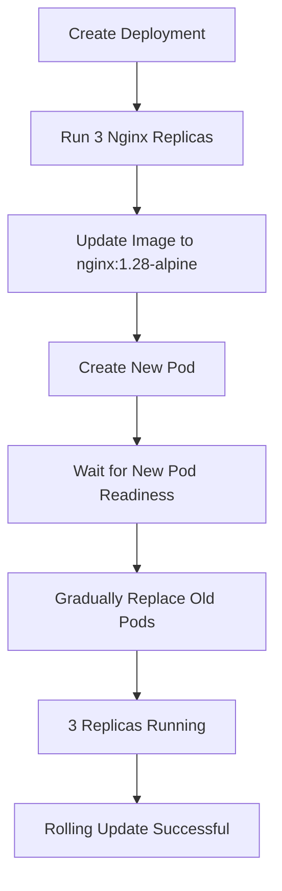

### 7.2 Faulty Update and Rollback

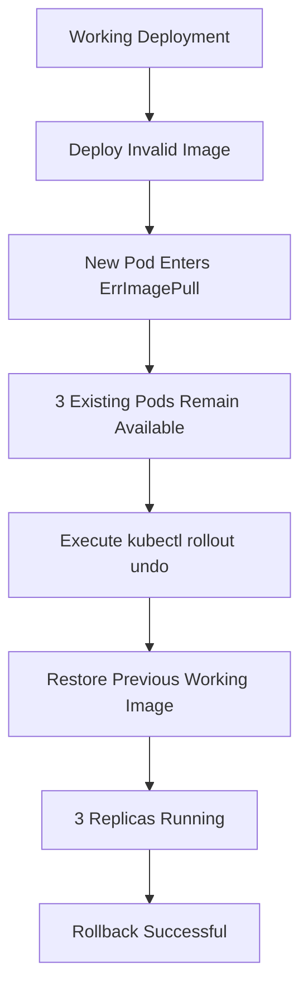

### 7.3 Application Version Flow

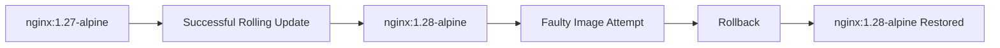

### 7.4 Application Availability Graph

The graph shows the number of healthy, available application replicas observed at each stage. The Deployment was configured with three replicas and `maxUnavailable: 0`.

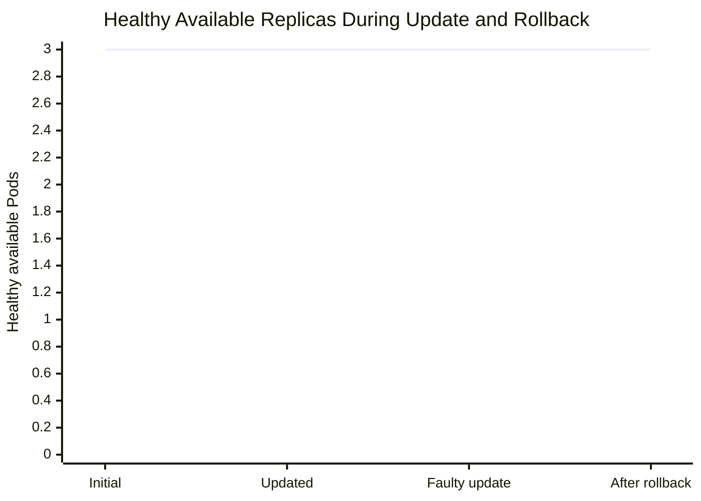

**Observation:** Three healthy replicas remained available at all four checkpoints. During the faulty update, the additional new Pod failed with `ErrImagePull`; it is not counted as a healthy available replica. After rollback, the Deployment returned to the working `nginx:1.28-alpine` image with three ready replicas.

**Note:** This is an availability observation graph, not a response-time or throughput benchmark. No performance timings were collected in this experiment.

## 8. Screenshots and Implementation Evidence

The following screenshots were captured during the practical implementation.

### 8.1 Initial Deployment

Three Nginx replicas were successfully deployed using the initial image version `nginx:1.27-alpine`.

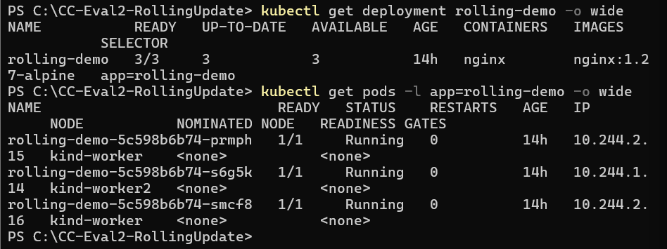

### 8.2 Successful Rolling Update

The application was successfully updated from `nginx:1.27-alpine` to `nginx:1.28-alpine`.

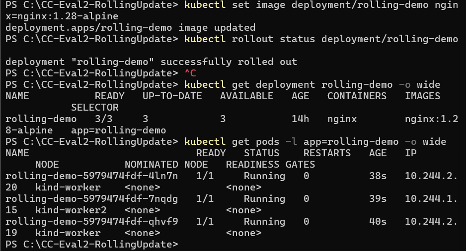

### 8.3 ReplicaSet Replacement

The new ReplicaSet was created and the old ReplicaSet was scaled down during the rolling update.

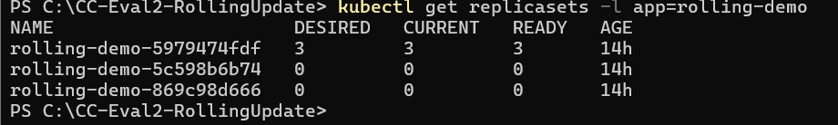

### 8.4 Faulty Image Update

An invalid image version was deployed. The new Pod entered the `ErrImagePull` state while the existing healthy Pods remained available.

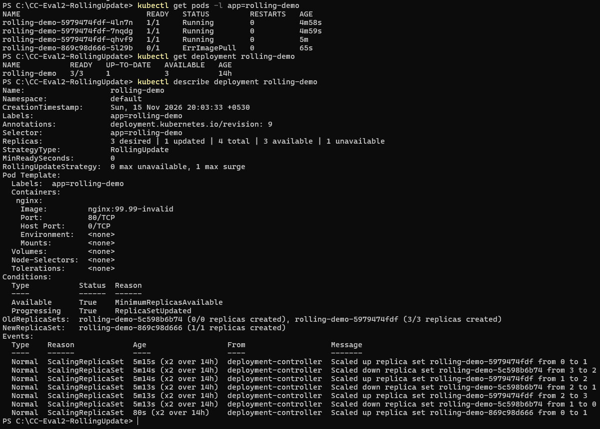

### 8.5 Successful Rollback

The faulty Deployment was reverted using `kubectl rollout undo`.

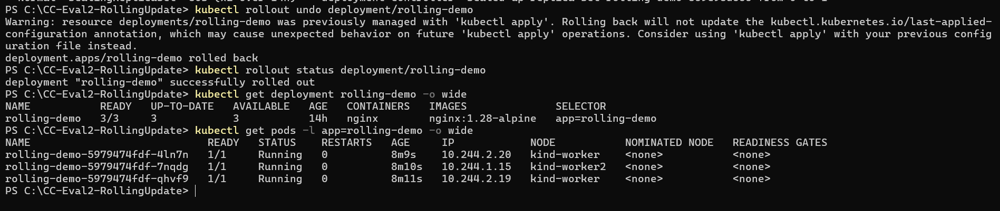

### 8.6 Final Deployment

After rollback, the Deployment had three ready replicas using `nginx:1.28-alpine`.

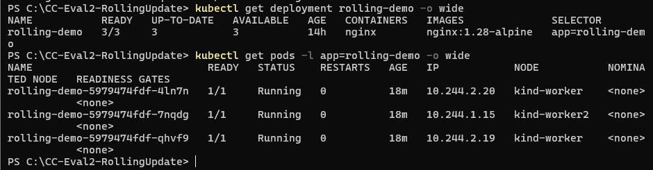

### 8.7 Rollout History

The recorded Deployment revisions were checked using `kubectl rollout history`.

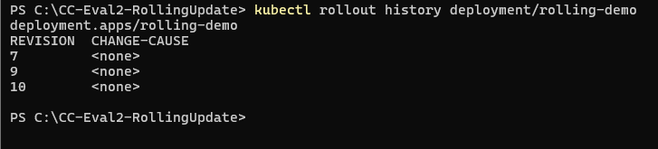

### 8.8 Application Test

The Nginx Welcome page was accessed through the Kubernetes Service using port forwarding.

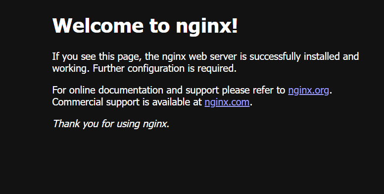

## 9. Results and Observations

The experiment was completed successfully.

| Test | Observed Result |
|---|---|
| Initial Deployment | 3/3 replicas Running |
| Initial image | nginx:1.27-alpine |
| Successful image update | nginx:1.28-alpine |
| Rolling update status | Successfully rolled out |
| Faulty image | nginx:99.99-invalid |
| Faulty Pod status | ErrImagePull |
| Existing healthy replicas during faulty update | 3 available |
| Rollback status | Successfully rolled out |
| Final image | nginx:1.28-alpine |
| Final replicas | 3/3 ready |
| Final Pod restarts | 0 |
| Application test | Nginx Welcome page displayed |

### Key Observations

1. Kubernetes successfully deployed the application with three replicas.
2. The RollingUpdate strategy gradually replaced the old Pods with new Pods.
3. The application image was updated successfully to `nginx:1.28-alpine`.
4. The invalid image resulted in an `ErrImagePull` error.
5. The three existing healthy Pods remained available during the faulty update.
6. The rollback operation restored the previous working image.
7. The final Deployment had three ready replicas.
8. The application was accessible through the Kubernetes Service.

## 10. Conclusion

This experiment demonstrated Kubernetes Rolling Updates and Rollback of Deployments.

An Nginx application was deployed with three replicas and configured using the RollingUpdate strategy.

The application was successfully updated from `nginx:1.27-alpine` to `nginx:1.28-alpine`. A faulty image was then deployed deliberately to demonstrate an unsuccessful update.

The faulty update was reverted using `kubectl rollout undo`, which restored the previous working image.

Finally, all three replicas were verified as Running, and the application was accessed through the Kubernetes Service.

Thus, the experiment demonstrated how Kubernetes supports controlled application updates, maintains available replicas during an update, and provides rollback to recover from a faulty release.

## 11. Project Folder Structure

```text
CC-Eval2-RollingUpdate/
│
├── deployment-v1.yaml
├── service.yaml
├── README.md
│
└── screenshots/
    ├── 01-initial-deployment.png
    ├── 02-rolling-update-success.png
    ├── 03-replicaset-replacement.png
    ├── 04-faulty-update.png
    ├── 05-rollback-success.png
    ├── 06-final-deployment.png
    ├── 07-rollout-history.png
    └── 08-application-test.png
```

---

**End of Project Documentation**
